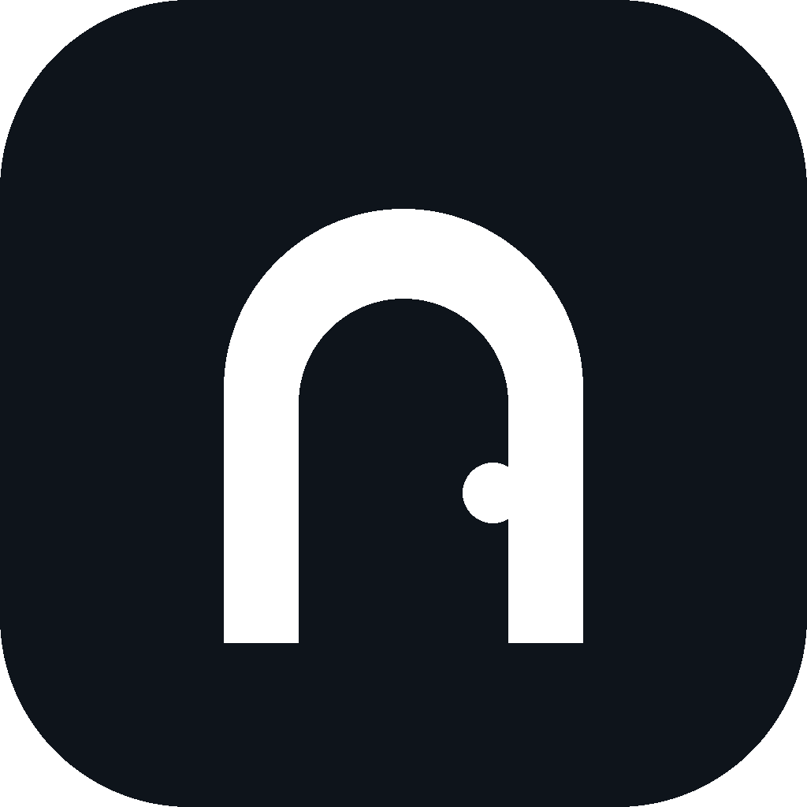

<p align="center">
  
</p>

# HavenOS

-blue.svg)


**HavenOS is a launcher** — a tablet-first, Minimal home screen for Android,
written in Kotlin and Jetpack Compose. One design language, no theme store,
no accounts, no ads, no analytics. The only network feature is an optional
weather widget.

- **Package:** `app.havenos.launcher`
- **Minimum Android:** 8.0 (API 26) · **Target:** Android 16 (API 36)
- **Latest release:** [v1.0 (versionCode 10)](CHANGELOG.md) — see
  [Releases](https://github.com/Voidwalker-28/HavenOS/releases) for the APK.

> HavenOS is a launcher, not an operating system. It replaces your home
> screen; it does not replace Android.

## What it looks like

Minimal, spacious, and quiet. Three semantic surfaces, one accent colour,
glass used sparingly as part of the Minimal material — nothing else to
configure, nothing competing for attention.

### Screenshots

Screenshots will be added here from a real device run. No mockups are
presented as screenshots.

| Home (tablet landscape) | Today rail | Library |
|---|---|---|
| _coming soon_ | _coming soon_ | _coming soon_ |

## Features

### Home

- **Horizontal paged home.** Swipe between pages. Add pages, and remove
  them too: empty pages delete freely, non-empty pages move their items to
  an adjacent page with undo, and the last page can never be deleted.
  Items are never silently lost.
- **One layout engine.** A single occupancy-aware engine (validate, push,
  reflow) keeps icons, folders, and widgets from ever overlapping, and the
  widget host grid matches the pager grid exactly.
- **Grid and density controls.** Grid size settings apply to both
  orientations and reflow the layout with ghost cells and destination
  pages. Density levels: Spacious, Balanced (default), Dense, Custom.
- **Edit mode.** Long-press to edit: a 56dp toolbar, a context bar,
  collision policy, 50-level undo, layout snapshots, and Restore layout.
  Drag apps between pages and in and out of the dock.
- **Legibility engine.** Icon labels adapt to the wallpaper behind them,
  with a pill fallback when no per-cell wallpaper statistics are available.

### Taskbar dock

One persistent dock lives **outside** the pager, so it is identical on
every page:

- **Floating glass pill**, bottom-centre by default, with Left and Right
  positions that turn it into a vertical rail.
- **Contents:** pinned apps · divider · up to 3 recent apps · Search
  button · Library button.
- **Slot count is computed from the available width**, and icons never
  shrink below 48dp — the dock scrolls instead of squeezing.
- **Drag in and out.** Drag apps from the Library into the dock and out
  of it in edit mode.
- **Reserved space.** The grid reserves exactly the dock's space, and the
  page indicator sits above the dock — the bottom row never touches the
  screen edge.
- **Contrast-checked.** Icon contrast is checked against the dock
  material so icons stay readable.
- The dock is persistent across home pages, the Today page, and edit mode.
  Full-screen overlays (Library, Settings) sit above it, Calm mode covers
  it, and an optional auto-hide dims it (off by default).

### Today

- **Tablet landscape:** a Today rail (~30%) beside the workspace (~70%).
- **Medium screens:** a collapsible Today strip.
- **Compact screens:** a Today pager page.
- Today carries a card flow: calendar agenda, weather, and a Smart Stack.
  Cards can be reordered in the flow.

### Library (app drawer)

All apps, List, and Categories views, with live ranked search, a search
pill, and a 48dp A–Z scrubber. Folders open as a panel with a 4-column
grid; folder previews are size-driven (3×3, or a large 2×2 with quadrant
tap). There is no folder preview-mode setting.

### Widgets

Real hosted widgets via `AppWidgetHost` — including third-party widgets —
with a picker that shows live previews before adding. A fresh install
seeds one clock card. Widget surfaces are transparent glass by default.

### Calm mode

A focus list (up to 8 apps) with a real editor: choose apps, schedule,
and entry options. Everything else steps aside.

### Appearance: Minimal + accent colour

HavenOS has exactly one design language: **Minimal**. There are no theme
presets, no look switcher, and no templates. The only theme control is
the **accent colour** — Default, Palette, or Custom — which recolours
buttons, toggles, and highlights while Minimal stays unchanged. There is
no wallpaper-derived accent.

### Gestures (own layer)

HavenOS ships its own gesture layer, powered by accessibility: swipe up
from the bottom edge for Home, up-and-hold for Recents, and swipe in from
either side edge for Back — working in every app. This is needed because
some manufacturers block system gesture navigation for third-party
launchers at OS level, and no app-side bypass exists for that. The layer
is off by default and requires the accessibility service and the
draw-over-other-apps permission.

### Weather (optional)

Weather comes from Open-Meteo only — the app's sole network feature, and
it can be switched off (off means cached data only). See
[docs/LICENSES.md](docs/LICENSES.md) for the attribution and terms.

### Settings

Six hubs, lean rows, and honest controls: every row does what it says.
Settings includes search-that-acts, a Before/Undo/Changes trail for the
session, and backup import with undo. On tablets, Settings is a
master-detail layout beside the live home.

## Building

See [BUILDING.md](BUILDING.md). Short version: JDK 17, Android SDK
(compileSdk 36, build-tools 35.0.0), Gradle 9.3.1, then:

```sh
gradle :app:assembleRelease
```

## Contributing

See [CONTRIBUTING.md](CONTRIBUTING.md). The standing rules: smallest
complete change, no new features without discussion, original code only.

## Releasing

See [RELEASING.md](RELEASING.md). Every version updates the code, the
CHANGELOG, the README version, and ships a tag plus a GitHub Release
with the APK.

## License

HavenOS's own code is MIT — see [LICENSE](LICENSE). Third-party
libraries and the Open-Meteo terms are listed in
[docs/LICENSES.md](docs/LICENSES.md).

## Documentation

- [CHANGELOG.md](CHANGELOG.md) — version history
- [BUILDING.md](BUILDING.md) — build instructions
- [docs/COVERAGE.md](docs/COVERAGE.md) — what is built, partial, or blocked
- [docs/ARCHITECTURE.md](docs/ARCHITECTURE.md) — code map
- [docs/LICENSES.md](docs/LICENSES.md) — third-party licenses

## Marketing website

The HavenOS product website lives in [`website/`](website/). It is a static Vite/React site that uses the supplied screen recording for its video-led hero and real UI evidence. Run it with `cd website && pnpm install && pnpm dev`.
